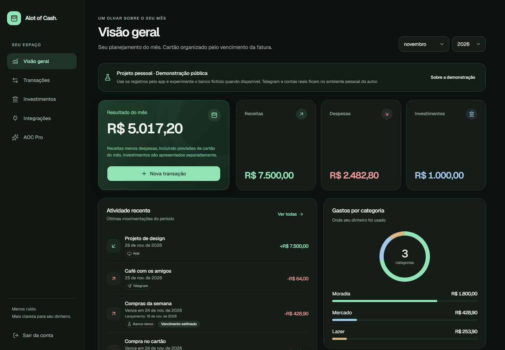
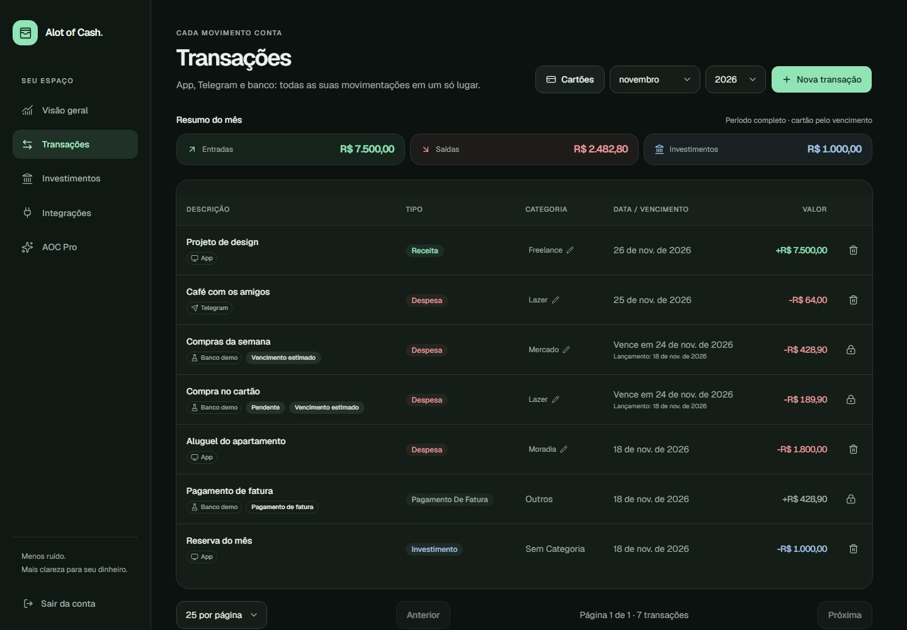
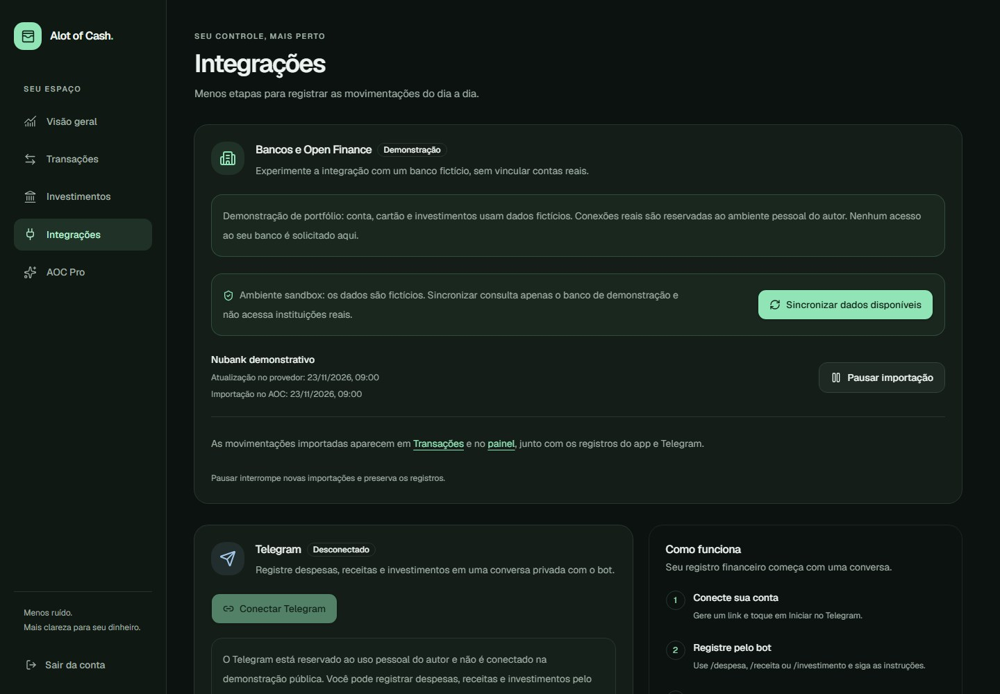
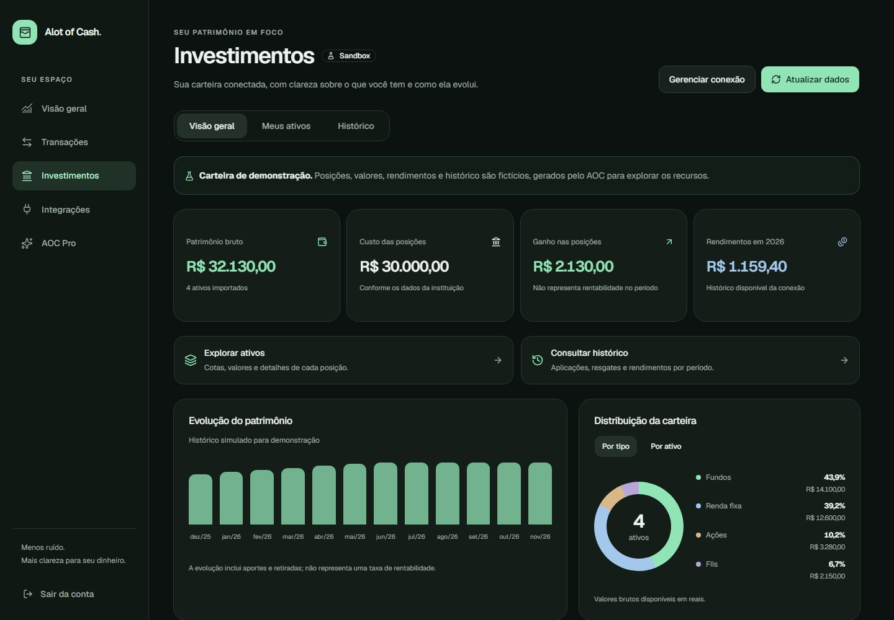
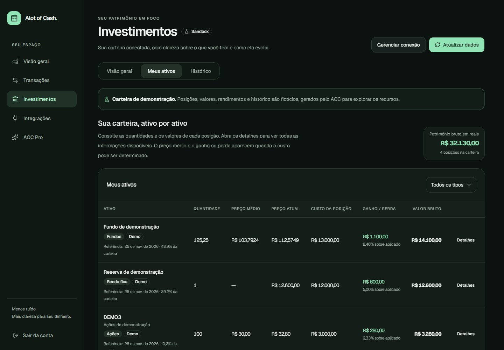
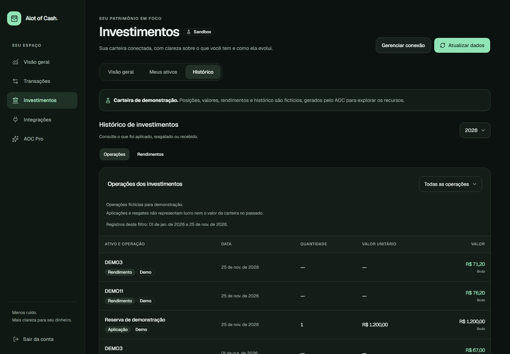
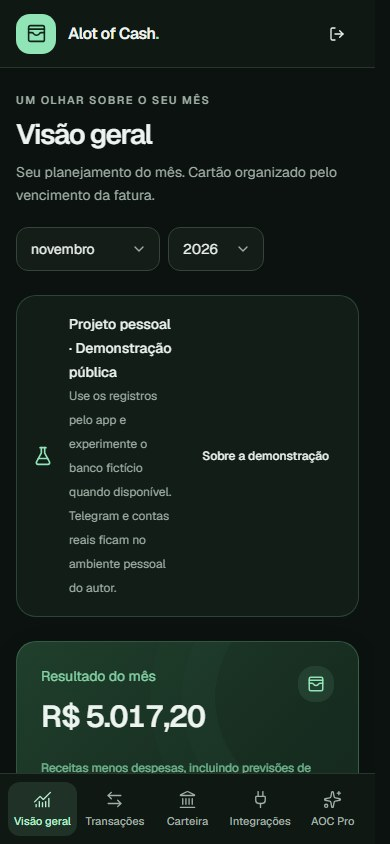
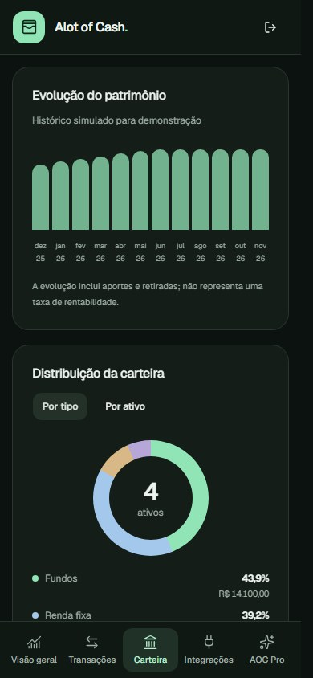
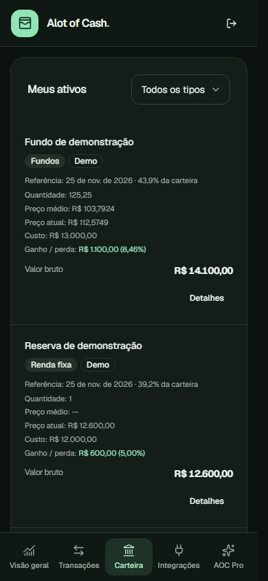

# 💰 ALOT OF CASH

Aplicativo de finanças pessoais para acompanhar o mês, organizar despesas de cartão e explorar uma carteira de investimentos em um só lugar.

O **AOC** é um projeto pessoal que faz parte do meu portfólio profissional. Ele reúne registros pelo aplicativo, integração com Telegram e sincronização bancária via Pluggy, com uma demonstração pública e um ambiente pessoal para as conexões reais.

[Demonstração](https://frontaoc.vercel.app/login) · [Frontend](https://github.com/GustavoAlot/alotofcash) · [Backend](https://github.com/GustavoAlot/AOC_new_bacck) · [Documentação](#documentação)

Este repositório reúne a apresentação do projeto e os prints. O código e a documentação técnica ficam nos repositórios de frontend e backend indicados acima.

## De um trabalho de faculdade a um projeto pessoal

O projeto começou nos primeiros períodos da faculdade, em **C++**, usando arquivos **`.txt`** para armazenar os dados. A ideia era simples: registrar entradas e saídas para entender melhor o próprio dinheiro.

Com o aprendizado em **Node.js e React**, transformei essa primeira versão em uma aplicação web. Desde então, o AOC passou a incorporar autenticação, persistência em MongoDB, integração bancária, bot no Telegram e uma área dedicada a investimentos.

Hoje, ele continua sendo um espaço para desenvolver e demonstrar minhas habilidades, trabalhando tanto na interface quanto nas regras de negócio, integrações, testes e documentação.

## Demonstração pública e uso pessoal

**A versão pública é uma demonstração de portfólio.** Você pode entrar com Google, registrar movimentações e experimentar os recursos disponíveis. As conexões reais de banco, cartão, investimentos e Telegram ficam no meu ambiente pessoal local.

Manter essas integrações abertas ao público envolve custos que este projeto não comporta. Por isso, a demonstração usa dados bancários fictícios e não solicita acesso à conta real do visitante.

| Recurso                               | Demonstração pública          | Ambiente pessoal local                     |
| ------------------------------------- | ----------------------------- | ------------------------------------------ |
| Login Google e registros pelo app     | Disponível                    | Disponível                                 |
| Painel mensal, categorias e listagens | Disponível                    | Disponível                                 |
| Banco e cartão via Open Finance       | Sandbox, quando configurado   | Conexão real restrita à conta proprietária |
| Carteira de investimentos             | Simulação com dados fictícios | Dados da instituição conectada             |
| Bot Telegram                          | Bloqueado                     | Uso pessoal integrado às mesmas listagens  |

A restrição das integrações é aplicada pelo **backend**, inclusive para a conta proprietária no modo público.

> A disponibilidade depende da hospedagem e dos serviços utilizados, e os recursos podem variar conforme a versão publicada. Prefira dados fictícios ao experimentar e não use a demonstração como seu único controle financeiro. Todos os prints deste README mostram dados fictícios.

## Funcionalidades

### Planejamento financeiro

- Registro de **despesas, receitas e lançamentos de investimento**, com categorias e formas de pagamento.
- Visão geral com receitas, despesas, investimentos e resultado do mês.
- Atividade recente e distribuição dos gastos por categoria.
- Filtros por período, paginação e resumo do mês completo nas transações.
- Edição de categorias de despesas e receitas, preservada nas próximas sincronizações bancárias.
- Identificação da origem de cada registro: **App, Telegram, Banco ou Banco demo**.

### Cartão e Open Finance

- Importação das movimentações disponibilizadas pela instituição conectada via **Pluggy**.
- Despesas de cartão organizadas pelo **mês do vencimento da fatura**, preservando a data original do lançamento.
- Configuração de fechamento e vencimento para prever o mês de pagamento.
- Identificação de parcelas, pendências e vencimentos estimados.
- Pagamentos de fatura identificados ficam fora das receitas e despesas, evitando contar novamente as compras já registradas.
- Registros bancários protegidos contra exclusão, com histórico preservado ao pausar a sincronização.

A sincronização pessoal pelo Meu Pluggy segue a atualização diária disponibilizada pelo provedor; não é uma integração em tempo real. Depois da importação, os registros ficam salvos no MongoDB, e consultar as telas não exige uma nova chamada à Pluggy.

### Carteira de investimentos

- Patrimônio bruto, custo das posições e ganho ou perda quando existem dados suficientes.
- Distribuição da carteira por tipo de investimento ou por ativo.
- Evolução do patrimônio a partir dos valores coletados nas sincronizações.
- Listagem de ativos com quantidade, valor unitário, preço médio e detalhes da posição, conforme os dados disponíveis.
- Histórico de operações e rendimentos, com filtros por ano, tipo de operação e paginação.
- Importação de até **365 dias de operações**, conforme o histórico disponibilizado pela instituição.

O AOC não inventa valores ausentes: preço médio e ganho só aparecem quando o custo informado é utilizável ou o histórico permite reconstruir a posição. Ganho na posição não equivale à rentabilidade da carteira no período, e o histórico de operações não é tratado como uma série completa de valores antigos do patrimônio.

### Telegram e experiência de uso

No ambiente pessoal, o bot permite registrar despesas, receitas e investimentos em uma conversa privada, com confirmação antes de salvar. Os registros aparecem nas mesmas listagens do aplicativo.

A interface é responsiva, com navegação adaptada ao celular, tema escuro, tipografia Geist, tooltips acessíveis e animações que respeitam a preferência por movimento reduzido. A landing apresenta uma galeria navegável das telas, com prints para desktop e mobile.

## Conheça as telas

Capturas da aplicação com um banco de testes isolado e dados fictícios.

<strong>Transações, integrações e carteira de investimentos</strong>

### Transações

Resumo mensal, filtros, categorias e identificação da origem de cada lançamento.

### Integrações

Banco demonstrativo e explicação da restrição do Telegram na versão pública.

### Visão geral dos investimentos

Indicadores da carteira, evolução do patrimônio e distribuição por classe.

### Meus ativos

Posições com quantidades, preços e ganho ou perda quando o custo pode ser determinado.

### Histórico de investimentos

Operações e rendimentos disponíveis, com filtros e paginação.

<strong>Experiência no celular</strong>

  
  
  

## Tecnologias

| Área         | Tecnologias                                                                                  |
| ------------ | -------------------------------------------------------------------------------------------- |
| Frontend     | React 18, Vite 7, React Router, Tailwind CSS 4, Base UI/shadcn, Lucide e Axios               |
| Backend      | Node.js 24, Express 4 e Mongoose                                                             |
| Persistência | MongoDB                                                                                      |
| Autenticação | Login Google via Firebase Authentication e sessão da API com JWT                             |
| Integrações  | Pluggy para Open Finance e grammY para o bot Telegram                                        |
| Qualidade    | Vitest, Testing Library, Playwright, testes nativos do Node.js, Supertest, ESLint e Prettier |

O frontend e o backend possuem repositórios independentes. A API concentra autenticação, autorização, validações, filtros, paginação e cálculos financeiros; o frontend cuida da apresentação e da interação.

## Qualidade

Os testes da aplicação cobrem regras financeiras, autorização, isolamento entre usuários, modos real e sandbox, integrações simuladas, paginação e navegação em desktop e celular. Os testes de integração e navegador usam bancos temporários e dados fictícios; não acessam o banco pessoal.

## Documentação

- [Desenvolvimento do frontend: estrutura, rotas, testes e build](https://github.com/GustavoAlot/alotofcash/blob/8548cb4050095dc1211f61cb4fd476cf76f8f36e/README.md)
- [Demonstração pública, publicação e atualização dos prints](https://github.com/GustavoAlot/alotofcash/blob/8548cb4050095dc1211f61cb4fd476cf76f8f36e/docs/portfolio.md)
- [Transações, categorias e paginação](https://github.com/GustavoAlot/alotofcash/blob/8548cb4050095dc1211f61cb4fd476cf76f8f36e/docs/transactions.md)
- [Planejamento das despesas de cartão](https://github.com/GustavoAlot/alotofcash/blob/8548cb4050095dc1211f61cb4fd476cf76f8f36e/docs/card-billing.md)
- [Fluxos da integração Open Finance](https://github.com/GustavoAlot/alotofcash/blob/8548cb4050095dc1211f61cb4fd476cf76f8f36e/docs/open-finance-interface.md)
- [Carteira e cálculos de investimentos](https://github.com/GustavoAlot/alotofcash/blob/8548cb4050095dc1211f61cb4fd476cf76f8f36e/docs/investments.md)
- [Contexto para manutenção com agentes de IA](https://github.com/GustavoAlot/alotofcash/blob/8548cb4050095dc1211f61cb4fd476cf76f8f36e/AGENTS.md)
- [Backend: API, persistência, integrações e operação](https://github.com/GustavoAlot/AOC_new_bacck)

## Evolução do projeto

Possíveis próximos passos incluem conciliação entre lançamentos manuais e bancários, ampliação das análises quando houver dados confiáveis e melhorias contínuas de usabilidade e acessibilidade.

Essas ideias não representam recursos já implementados nem um compromisso de prazo. O foco continua sendo evoluir um aplicativo útil no meu dia a dia e um projeto de portfólio bem documentado.
